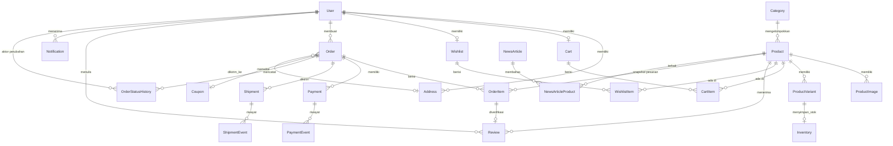

# ERD — Stride Athletics

Sumber: `server/prisma/schema.prisma`. Semua primary key `Int autoincrement`.
Nominal uang disimpan sebagai `Int` (rupiah). Status disimpan sebagai `String`
(konstanta di aplikasi) agar kompatibel SQLite dan PostgreSQL.

## Relasi kunci

- `ProductVariant` unik pada `(productId, size, color)`; stok ada di `Inventory` per varian.
- `OrderItem` menyimpan snapshot `productName`, `sku`, `size`, `color`, `unitPrice`, `lineTotal`.
  `productId`/`variantId` boleh `NULL` (SetNull) agar riwayat tetap ada saat produk dihapus.
- `PaymentEvent.eventKey` unik untuk idempotensi webhook; `PaymentEvent.payload` menyimpan body notifikasi.
- `Review.orderItemId` unik sehingga satu item pesanan hanya bisa diulas sekali (ulasan terverifikasi).
- `OrderStatusHistory` memisahkan status order, payment, dan shipment beserta sumber perubahan.
- Soft delete: `Product.deletedAt`, `User.deletedAt`.

## Constraint & index penting

| Tabel | Constraint / Index |
| --- | --- |
| User | `email` unik, index `role` |
| Product | `sku` unik, `slug` unik, index `(categoryId, isPublished)`, `(isPublished, effectivePrice)` |
| ProductVariant | `sku` unik, `(productId, size, color)` unik |
| Inventory | `variantId` unik |
| Cart / Wishlist | `userId` unik (satu cart/wishlist per user) |
| CartItem | `(cartId, variantId)` unik |
| WishlistItem | `(wishlistId, productId)` unik |
| Order | `orderNumber` unik, index `(userId, createdAt)`, `status` |
| Payment | `providerTransactionId` unik |
| Coupon | `code` unik |
| HelpArticle / NewsArticle | `slug` unik |

## Stok & reservasi

`Inventory.quantity` = stok fisik, `Inventory.reserved` = stok tertahan order
yang belum dibayar. Stok tersedia = `quantity - reserved`. Reservasi dan pelepasan
dijalankan dalam database transaction pada Milestone 5.
